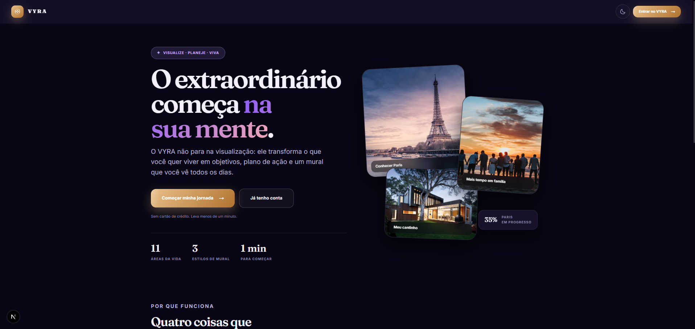

# VYRA

App Next.js 16 (App Router) para visualizar, planejar e realizar: sonhos viram
objetivos, objetivos viram plano de ação, e tudo isso vira um mural que você vê
todos os dias.

## Preview



## Os dois tipos: dia e noite

O VYRA tem duas atmosferas, não só duas cores:

| | Dia | Noite |
|---|---|---|
| Cenário | nascer do sol, montanhas douradas | aurora boreal, céu estrelado |
| Fundo | marfim quente (`--w-50`) | índigo profundo (`--i-950`) |
| Destaque | âmbar (`--g-600`) | lilás (`--v-400`) |
| Marca | ouro | ouro |

O ouro é a assinatura e vale nos dois tipos — é ele que pinta todo botão
principal e o símbolo. O violeta é ambiente da noite; de dia ele recua.

A escolha vive em `[data-theme]` no `<html>` (`light`, `dark`, ou ausente para
"automático", que segue o `prefers-color-scheme` do aparelho). Quem decide o
visual é sempre o CSS, nunca o estado do React — ver `app/styles/tokens.css`,
`components/ThemeToggle.tsx` e `components/ThemePicker.tsx`.

## O cenário

Toda tela tem uma **fotografia de paisagem ocupando o fundo inteiro**, com a
interface flutuando em vidro por cima — não é um cartão com foto dentro de uma
tela lisa, é a tela que é a paisagem. Quem monta isso é `<Ambience />`, que
toda tela renderiza, em quatro camadas:

1. **foto** — a paisagem, ancorada embaixo
2. **véu** — sólido no topo, onde mora o texto, abrindo até a foto aparecer
3. **manchas** — o brilho de cor que tinge a cena
4. **estrelas** — só à noite

Cada tela declara a sua ambientação (`data-ambience` no `<main>`: `sunrise`,
`aurora`, `mountains`, `stars`, `horizon`), e **a foto muda com o tipo**: de dia
entram nascer do sol e montanhas; de noite, aurora boreal e céu estrelado. Um
filtro (`--scene-filter`) puxa qualquer foto para a paleta do tipo ativo, então
o cenário nunca briga com a interface.

O véu é o que permite ter foto na tela toda sem que nenhum texto dependa da
sorte de cair sobre uma parte escura da imagem.

```bash
npm run dev     # sobe a API mock e depois o app
npm run build
npm run lint
```

`npm run dev` orquestra dois processos: o **json-server sobe primeiro** (porta
3333) e o Next só inicia depois que a API responde, via `wait-on`. App em
`http://localhost:3000`, API em `http://localhost:3333`.

O plano de trabalho e o status de cada tela ficam em
[10-setembro-plano-inicio.md](10-setembro-plano-inicio.md). A revisão de pastas,
correções e performance, com as etapas e o status de cada uma, está em
[24-setembro-pastas.md](24-setembro-pastas.md). A visão geral, com percentuais e
a comparação com concorrentes, está no [manual.html](manual.html): abra no
navegador. Ele usa o Tailwind por CDN e fica fora da varredura do Tailwind do
app (`@source not` em `app/globals.css`).

---

## Design system

O visual não vive espalhado pelos componentes: tudo sai de uma camada de tokens.
Trocar uma variável em `app/styles/tokens.css` muda o app inteiro, nos dois temas.

### Camadas de CSS

`app/globals.css` importa as camadas nesta ordem — da mais genérica para a mais
específica, para que a cascata funcione a favor e não contra:

| Arquivo | Responsabilidade |
| --- | --- |
| `styles/tokens.css` | Cor, tipografia, espaço, raio, sombra, easing. Fonte única de verdade. |
| `styles/base.css` | Reset, canvas com aurora, tipografia padrão, foco, scrollbar. |
| `styles/motion.css` | Keyframes, cascata de entrada, scroll reveal, `prefers-reduced-motion`. |
| `styles/layout.css` | Shell do app, navegação adaptativa, contêiner de página. |
| `styles/components.css` | Botões, cartões, chips, perfil e detalhe — o catálogo visual. |

Depois dessas vêm `ambience.css` (o cenário), `brand.css`, `vyra.css`,
`onboarding.css`, `landing.css` e `forms.css`. A ordem exata está em
`app/globals.css`.

### Tema claro e escuro

Light é a base em `:root`. Dark é aplicado em dois lugares, com os mesmos valores:

1. `@media (prefers-color-scheme: dark)`, guardado por `:not([data-theme="light"])`
   para que a escolha manual sempre vença o sistema.
2. `:root[data-theme="dark"]`, que é a escolha explícita do usuário.

Nenhuma cor é definida apenas dentro de uma media query, então o toggle funciona
nas duas direções. A preferência persiste em `localStorage` (`vyra-theme`) e um
script inline no `<head>` a aplica antes do primeiro paint — sem flash de tela
branca em quem usa o tema escuro. Quem nunca tocou no toggle continua seguindo o
sistema operacional.

A troca é animada com a View Transitions API: o tema novo é revelado por um
círculo que cresce a partir do próprio botão clicado.

### Responsividade

Três regimes de layout, uma única árvore de DOM:

| Largura | Layout |
| --- | --- |
| `< 1024px` | Barra de navegação inferior fixa, conteúdo em coluna única. |
| `>= 1024px` | A navegação vira trilha lateral fixa com marca e rótulos. |
| `>= 1320px` | Entra uma terceira coluna (`.page-split` + `.page-aside`) com resumo e frases. |

O hero passa a duas colunas em `>= 860px`, a grade de sonhos vai de 2 para 3
colunas em `>= 700px`, e a lista de categorias para 2 colunas em `>= 760px`.
Tipografia e gutters usam `clamp()`, então escalam entre os breakpoints em vez de
pular.

### Movimento

- Entrada em cascata (`.stagger`) no cabeçalho e no hero de cada página.
- Scroll reveal via `IntersectionObserver` (`<Reveal>`), que solta o alvo depois
  de revelar para não re-animar.
- Barras de progresso preenchem do zero com uma varredura de luz.
- Hover só dentro de `@media (hover: hover)`, para o toque não herdar estados
  presos; press usa `transform`, que não causa reflow.
- Todo o movimento é desligado em `prefers-reduced-motion: reduce`, mantendo o
  conteúdo visível.

### Acessibilidade

Os 13 pares de cor texto/fundo dos dois temas passam WCAG AA (4.5:1). Estado
ativo de navegação usa `aria-current="page"`, os chips usam `aria-pressed`, as
barras de progresso são `role="progressbar"` com valor, e o foco é visível via
token `--ring`.

---

## Estrutura

Toda rota mora em um dos três route groups, que não aparecem na URL:

```
app/
├── layout.tsx              raiz: fontes, script de tema, viewport
├── globals.css             importa as camadas de estilo
├── styles/                 o design system (tabela acima)
│
├── (site)/                 público, com SiteHeader e rodapé
│   ├── page.tsx            → /             landing
│   ├── cadastro/           → /cadastro
│   └── login/              → /login
│
├── (onboarding)/           fluxo de entrada (telas 1 a 9), sem navegação
│   ├── splash/  bem-vindo/  idioma/
│   ├── personalizacao/  planos/  pagamento/
│   └── pronto/  tutorial/
│
└── (app)/                  interno, com NavRail (barra no mobile, trilha no desktop)
    ├── inicio/             → /inicio       home do app
    ├── explorar/           → /explorar     templates, frases e lugares
    ├── objetivos/          lista, novo/ e [id]/ (plano de ação)
    ├── mural/              lista, novo/, [id]/editar e [id]/preview
    ├── area/[slug]/        vibração, mentalizar, saúde, profissão, religião, lugares
    ├── frases/             galeria e criar/
    ├── jornadas/           jornadas de atração: lista, [modulo]/ e [modulo]/dia/[dia]
    ├── categoria/[slug]/   detalhe de categoria
    ├── sonho/[id]/         detalhe de sonho (modelo antigo, sem link de entrada)
    ├── conta/              painel da conta: ver, editar e excluir o cadastro
    └── perfil/  configuracoes/  conquistas/  ajuda/  sobre/

app/api/voz/route.ts        API de voz: texto entra, áudio sai (ver "Voz do servidor")

components/                 UI compartilhada: NavRail, PageHeader, Ambience, Collage…
lib/
├── api.ts                  cliente da API mock — o único lugar que chama fetch
├── auth.ts                 sessão do protótipo (localStorage)
├── data.ts                 categorias, objetivos, plano de ação, frase do dia
├── desejos.ts              opções da criação por toque (mural e objetivo)
├── jornadas/               textos dos 31 dias de cada jornada, roteiro da voz, progresso
├── trilha.ts               música das jornadas, gerada na frequência de cada uma
├── voz.ts                  leitura em voz alta (síntese de voz do aparelho)
└── areas.ts  frases.ts  murais.ts  planos.ts  conquistas.ts
```

O caminho do onboarding é: `/splash` → `/bem-vindo` → `/idioma` → `/cadastro`
→ `/personalizacao` → `/planos` → `/pagamento` → `/pronto` → `/tutorial` →
`/inicio`.

> **Não crie `page.tsx` solto na raiz de `app/`.** Duas páginas que resolvem
> para a mesma URL (por exemplo `app/perfil/page.tsx` e
> `app/(app)/perfil/page.tsx`) quebram o `next build`. Foi o que o merge com
> `origin/main` trouxe de volta — ver a Etapa 1 de
> [24-setembro-pastas.md](24-setembro-pastas.md).

As fontes são **Fraunces** (display) e **Inter** (interface), auto-hospedadas via
`next/font` — sem requisição ao Google e sem salto de layout.

## Jornadas de atração

Seis jornadas (amor, carreira, prosperidade, saúde, família e fé), cada uma
com 31 dias de texto guiado, todos diferentes e no sentido daquele desejo. A
pessoa escolhe 7, 21 ou 31 dias; as mais curtas saltam pelo mesmo arco
(soltar → merecer → sentir → agir → agradecer). Um dia libera por dia de
calendário.

- **Voz:** a voz neural do servidor (`/api/voz`, abaixo) quando há chave
  configurada; sem chave, ou se ela falhar, a síntese de voz do próprio
  navegador (`lib/voz.ts`), frase por frase.
- **Música:** `lib/trilha.ts` gera os quatro timbres (tigela tibetana, pad,
  piano e ondas do mar) com a Web Audio API, afinados na frequência da jornada
  (528 Hz no amor, 741 Hz na carreira...). Nenhum arquivo de áudio é baixado.
  As frequências seguem a tradição do solfejo e aparecem como "associadas a",
  nunca como efeito garantido.
- **Progresso:** `lib/jornadas/progresso.ts`, em `localStorage`, como a sessão.
- **Peso:** os 186 textos ficam no servidor (`lib/jornadas/index.ts`); o
  cliente recebe só o texto do dia que vai tocar.

### Voz do servidor (`/api/voz`)

Texto entra, voz sai:

```http
POST /api/voz
Content-Type: application/json

{ "texto": "Eu abro espaço para um amor novo e leve.", "voz": "francisca" }
```

| Resposta | Quando |
| --- | --- |
| `200 audio/mpeg` | o áudio da frase |
| `400` / `413` | texto vazio, longo demais (>1000) ou voz desconhecida |
| `403` | o texto não é de uma jornada |
| `501` | sem `AZURE_SPEECH_KEY`: o app usa a voz do aparelho |
| `502` | o provedor falhou |

`GET /api/voz` diz se a voz está configurada e lista as vozes: `francisca`
(estilo calmo), `thalita`, `antonio` e `fabio`.

- **Provedor:** Azure AI Speech, por REST. Para ligar, copie `.env.example`
  para `.env.local` e preencha `AZURE_SPEECH_KEY` e `AZURE_SPEECH_REGION`
  (recurso "Speech" no portal do Azure; o plano gratuito F0 dá 500 mil
  caracteres por mês). Reinicie o `npm run dev` depois.
- **Custo:** cada frase é gerada uma vez por voz e guardada em `.cache/voz`
  (fora do git). As jornadas somam ~43 mil caracteres únicos por voz.
- **Só textos das jornadas:** a rota recusa (403) qualquer outro texto, para
  ninguém usar a chave do app como serviço de voz. Para ler outros textos,
  acrescente-os em `textoPermitido` (`lib/vozServidor.ts`).

## Dados

Duas fontes, por enquanto:

- **`db.json` + json-server** (porta 3333) — `usuarios`, `desejos`, `categorias`
  e `frases`. Todo acesso passa por `lib/api.ts`. O cadastro da pessoa é um
  CRUD completo:

  | | Tela | Função em `lib/api.ts` | json-server |
  | --- | --- | --- | --- |
  | Criar | `/cadastro` | `criarUsuario` | `POST /usuarios` |
  | Ler | `/login`, `/conta` | `autenticar`, `buscarUsuario` | `GET /usuarios?email=`, `GET /usuarios/:id` |
  | Editar | `/conta` (painel) | `atualizarUsuario`, `trocarSenha` | `PATCH /usuarios/:id` |
  | Excluir | `/conta` (painel) | `excluirUsuario` | `DELETE /usuarios/:id` |

  No painel a pessoa edita nome, e-mail, telefone, nascimento, cidade e bio,
  troca a senha (pedindo a atual) e exclui a conta (pedindo a senha). O login
  aceita `?voltar=/conta` para devolver a pessoa ao painel.
- **`lib/*.ts`** — mock estático em código (`data`, `areas`, `desejos`, `frases`,
  `murais`, `planos`, `conquistas`), ainda usado pelas telas internas. A migração para a
  API é o item 9 do plano.

Banco de dados real e autenticação de verdade são o item 10. Enquanto isso a
senha fica em texto puro e a sessão em `localStorage` — protótipo, não produção.
As imagens vêm do Unsplash por URL.
